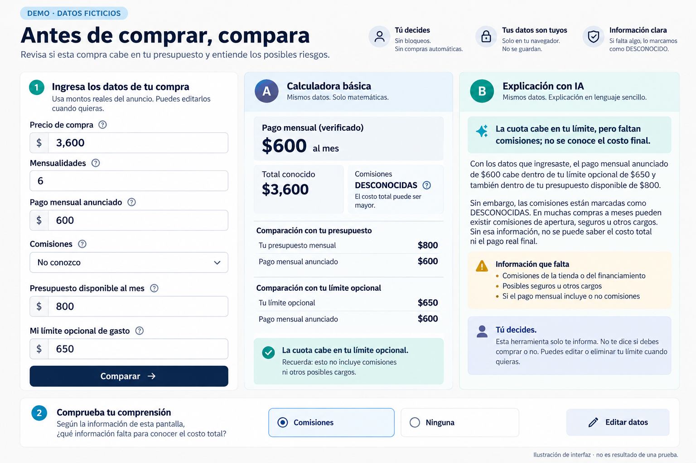
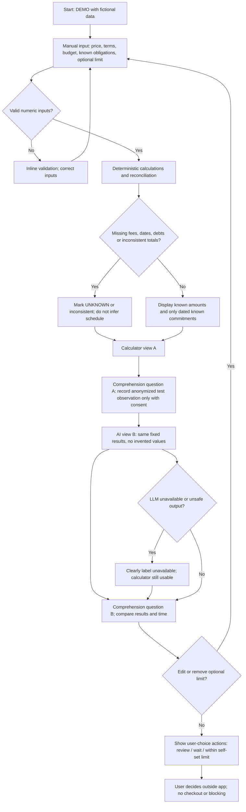
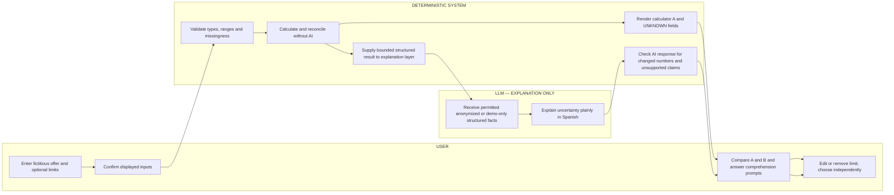

# WEEK 10 — BUSINESS BENDING | PACKET BEFORE CODE
**Debt Check MX: Reality Test** · Ana María Matas · ADVERSARY · Isle of Happiness  
**Status:** Stage 1 design packet, not built, deployed, or user-tested.  
**Authority:** `BLUEPRINT_team_WEEK10.pdf` (six conditions and declaration) and `BRIEF_AnaMariaMatas-2.pdf` (adversarial reasoning, benchmarks and kill conditions).

## 1. Problem — my ADVERSARY angle
My job is not to make AI look useful. A buyer considering installment payments may not know the full financing cost or how a new payment interacts with existing obligations. Ordinary software can already perform the arithmetic. I want to test whether a plain-language AI explanation leads to better understanding than the same correct result shown by a basic calculator. If it does not, the simpler tool wins. Financial stress, on its own, does not prove demand for this product. We must never confuse reducing borrowing with improving the buyer's choices.

## 2. Exact user and moment
A Mexican adult buyer, using their phone just before accepting a fictional installment offer online or in a store, who knows some amounts but may not know financing fees or exact due dates. They manually enter the purchase price, installment count, advertised payment if available, known additional charges, known existing obligations, available budget, and optional self-set payment limit. They do **not** provide bank passwords, account numbers or personal identities. The first prototype uses invented scenarios only, visibly labeled `DEMO · DATOS FICTICIOS`.

## 3. Success definition and falsification
**Before the module closes, a user can enter one fictional installment purchase, inspect correct deterministic calculator outputs and a clearly identified AI explanation based on the exact same verified inputs, compare their comprehension of missing information and payment conflicts, and change/remove any optional limit without the app making the purchase decision.**

Acceptance evidence: deployed functioning URL; transparent deterministic arithmetic; same numeric outputs in A/B; at least eight recorded mechanical edge-case scenarios; a demonstrated bug→fix→redeploy cycle; documented synthetic persona walkthrough; and an explicit comparison assessment, including an outcome of *no demonstrated AI advantage*. There is **no preset promise** that 30 seconds or superior AI performance has been achieved. The 30-second experience is an instrumented goal, not a measured result.

## 4. Image-generated mockup

**Mockup only:** Shows sample fictional price MXN 3,600, six advertised installments of MXN 600, available monthly budget MXN 800, and optional payment limit MXN 650. Fees are unknown: MXN 3,600 is **only the sum of advertised installments, not a verified total payable**. The full amount and schedule remain unknown. The illustrated AI text is **not a live model output**. Correct potential wording in implementation must be conservative: 'Con la información ingresada, la cuota anunciada está dentro del límite; los cargos adicionales y el total final son DESCONOCIDOS'. Mockup visual labels must not be mistaken for production behavior. Any mockup status text must not be copied without checking the calculation/uncertainty policy.

## 5. Mermaid flowchart — user journey and edge cases

## 6. Mermaid swimlane — actor responsibility

## 7. Global benchmark → Mexico
**Benchmark:** Undebt.it offers manual debt entry, debt payoff methods and calculation-driven comparisons without requiring bank credentials for its core calculator (official pages: https://undebt.it/how-undebt.it-works.php and https://undebt.it/pricing-features-reviews.php). **Local difference:** Debt Check MX is not a long-term repayment planner: it tests a single Mexican installment purchase, explicitly labels unknown costs and dates, and measures whether AI explanation beats a basic calculator in buyer understanding. Additional lessons from the individual brief: ClearScore's overview underscores coverage limitations and possible affiliate conflicts; StepChange illustrates human support, not proof of causal outcomes in Mexico. Do not describe any provider as a verified universal market leader; 'best existing solution' is the professor's benchmark framing, not a substantiated world ranking.

## 8. Long view — exactly three sentences
In three years, this could become a buyer-controlled pre-check used before different types of installment purchases in Mexico. It would remain independent of lenders and retailers, allowing people to compare known obligations and uncertainty without handing over bank credentials. Only if actual user studies establish better outcomes and an independent payer can cover the costs would we expand beyond the calculator-first comparison.

## 9. Hard scope cuts
**Not building:** banking app; lender connection; credit score; full debt inventory; BNPL coverage claims; checkout integration; purchase/blocking automation; behavioral ranking of 'good' purchases; real-time credit/price discovery; store; seller recommendation engine; referral commissions; PDF receipt OCR; persistent financial profiles; real financial data import; real repayment-calendar inference when dates are missing. No invented test results, savings claims or paid partnerships.

## 10. Architecture and Dragon Stack
| Layer | Plan | Security / limitation |
| --- | --- | --- |
| Next.js + TypeScript frontend | Responsive manual form, calculator/AI comparison, edge-case test panel | Browser-only ephemeral state, no localStorage for finances |
| Deterministic TypeScript core | Currency-as-integer-cents arithmetic, reconciliation, unknown flags, known dated-obligation conflicts | Only facts enter calculations; no LLM mathematics |
| User-constraint data | Purchases, obligations, budget, optional/editable/reversible limit | No identity, account number, login or persistence |
| LLM explanation (conditional) | Server-side transformation of **fictional/demo or explicitly consented, minimised** verified facts into short Spanish explanation | Model never determines permission to buy, figures or status; credentials server env only |
| Third component candidate | **Independent deterministic payment timeline / overlap engine** | Academic acceptance as 'one more' is **unconfirmed**, because it may count as app logic rather than distinct tech |
| Deployment | Vercel free tier; repository on GitHub | Env vars server only; no real financial examples |

**Stack-floor risk / gate:** The instructor says `LLM + user-constraint data + one more (vision for closet/receipts, price data, agent automation)`. The parenthetical may be examples, not exhaustive requirements. A deterministic timeline is valuable but **not unequivocally qualifying** as a distinct third technology. Seek professor/course confirmation *before coding*. If they require a distinct integration, smallest proposed fallback is a consent-free, fictional-offer screenshot *vision demo* with manual verification and no storage, separately scoped and approved first. This is **not** part of Option A unless the requirement is clarified. An LLM needs actual server-side inference or conspicuous `SIMULATED AI OUTPUT` labeling; static sample explanations cannot be advertised as live AI.

**Privacy decision gate:** Default test mode uses only fictional examples; server request payload contains no personal finance data. For live user-entered financial amounts, either use a fully disclosed opt-in external processing flow after explicit user approval, or disable external inference and label the local explanatory alternative clearly as simulated/rule-based. No silent transmission to an LLM. The present packet does not assert that a production LLM API or its free access is already available.

## 11. Mechanical test plan (planned, not executed)
| ID | Scenario (fictional) | Expected deterministic result |
| --- | --- | --- |
| M01 | MXN 3,600, six advertised payments of 600, fees unknown | Advertised subtotal 3,600; final total UNKNOWN; no inferred due dates |
| M02 | Fee field empty/unknown | UNKNOWN, never zero |
| M03 | Due date absent | Dates UNKNOWN; no fabricated monthly calendar |
| M04 | Two known dated obligations on same day | Show known overlap and amounts; only assert a shortfall if dated available funds are known |
| M05 | Irregular earnings with no dated cash-flow details | Cannot certify monthly affordability; status REVIEW / uncertainty |
| M06 | Available budget zero or negative | Do not show 'within available budget'; signed/zero results respected |
| M07 | Optional limit MXN 500, installment MXN 600 | Show exceeds self-set limit, allow edit/remove, never block |
| M08 | Input price 3,600, count 6, advertised payment 650, no fee breakdown | 6 × 650 = 3,900, difference 300; mark reconciliation difference, **not** assumed interest/fee |
| M09 | Invalid strings, huge numbers, negative price or zero installments | Inline error and no calculation; bounded ranges (e.g. price 0.01–1,000,000 MXN; count 1–120) |
| M10 | LLM invents total or changes number | Reject/flag output; show calculator and message 'explicación no disponible' |
| M11 | Edit/remove spending limit | Results recompute; no permanent or hidden restriction |
| M12 | LLM endpoint unavailable | Basic calculator functions independently |

Unit tests: integer-cent normalization, overflow/range, unknown propagation, missing date handling, reconciliation, optional limit state, A/B numeric parity, AI output validation. Browser/mobile checks: validation accessibility, narrow viewport, missing-data affordance, simulated labels and calculator fallback. **Mechanical requirement:** log a bug actually observed, fix it, rerun tests, redeploy; do not manufacture a bug.

## 12. Comparison experiment: calculator vs AI
Within the prototype, present the same scenario in two views. Require a short answer about which cost/date is unknown, whether a known payment exceeds a user-defined limit, and what additional information is needed; capture correctness and time only through consented test observation without personal identifiers. Prefer counterbalanced order (A→B for some, B→A for others), or label fixed-order outcomes as subject to learning effects. Ask separately '¿Lo usarías antes de pagar?' and '¿Por qué?'; distinguish stated intent from actual checkout behavior. Record number of participants, factual errors, comprehension correctness, completion time, clarity preference, and usability comments with raw evidence. **No participants or outcomes exist yet.** A synthetic persona does not establish real demand. If the calculator performs equally well, report no demonstrated AI advantage; do not claim causation from tiny samples.

## 13. Synthetic persona pass (planned)
**Synthetic, not interviewed:** 'Mariana, 27, Mexico City, salary varies across shifts, considering MXN 3,600 purchase in six advertised payments, comfortable with WhatsApp but unsure if advertised installments include fees.' This is a scenario hypothesis for simulation, not a portrait validated through field interviews. In a **fresh chat**, give only persona and sequential real screenshots; ask persona to attempt the task in character, verbalizing hesitation, interpretation, confusion, and abandonment. Log each screen, original words, severity and consequence. Select the worst observed issue, fix it, capture before/after screenshots and redeploy. Label synthetic persona feedback as simulation rather than real user research.

## 14. Build checkpoints (future only)
1. **Commit 1:** `docs/PACKET.md` and generated mockup/diagrams only (packet-before-code).
2. **Commit 2:** Manual input schema, validation and deterministic calculator + unit tests.
3. **Commit 3:** Calculator UI and edge-case responses; **Deploy 1** after security checks.
4. **Commit 4:** Comparison, comprehension questions and bounded AI/simulation labeling.
5. **Commit 5:** Bug fix discovered in mechanical pass, regression test and **Deploy 2**.
6. Optional further commits: persona usability fix, docs and session closes.
Each session: update `DECISIONS.md`, include tradeoffs, evidence, open risks and tomorrow's first move; commit and push. Deploy and commit counts are targets only, not achievements.

## 15. Security Floor
- [ ] No secrets in source, repo, client bundle, Git history or screenshots; server-only Vercel variables.
- [ ] No personal data stored. If that changes: Google sign-in via Supabase Auth plus RLS on every personal-data table **before deployment**.
- [ ] Reject malformed inputs; length limits, numeric bounds, no raw prompt concatenation; rate-limit server-side LLM requests if enabled.
- [ ] Fictional examples only in seeds, demos, screenshots and tests, clearly labeled.
- [ ] Do not send financial information to external AI without specific disclosure and informed consent; default only fictional data.
- [ ] No lender/retailer promotion or paid placement changing calculations.
- [ ] Never hide uncertainty, change numeric facts in AI output or make purchase decisions.

## 16. Economics and kill rules
Log **estimated marginal cost per check** = (paid model tokens × applicable rates + per-request paid infrastructure) / checks, with separate fixed costs, currency, date and pricing source; if simulated, label hypothetical at assumed usage rather than observed cost. Log any independent payer interview as actual date, role, direct question, verbatim answer, proposed amount and whether payment was committed, without conflating opinions with commitments. Track buyer-defined potential avoided charges/savings as **hypothetical scenarios** only until verified longitudinally. Treat 'benefit-to-cost 10:1' as an untested hypothesis, never a result. Kill standalone AI if correct information does not improve buyer-defined outcomes, simple tools perform just as well, unknown data makes explanation misleading, or no independent payer can cover costs without exploiting data or encouraging borrowing (per individual brief).

## 17. Evidence register and DECISIONS.md protocol
For each decision, record: date, context, option chosen/rejected, reason, Blueprint condition, evidence, unresolved risk, owner, next action. Maintain paths to: scenario test table and actual outputs; real screenshot sequence; synthetic persona transcript and verbatim confusion log; real-user interview/consent record if any; bug report and commit diff; Deploy 1/2 URLs; comparison metrics; estimate assumptions; shadow-clause checks; security checklist. At every session close append `What changed / What works / What is untested / First move tomorrow`, then commit and push.

## 18. Outstanding checks before approval
- Verify with course instructor whether deterministic timeline satisfies the distinct Dragon Stack 'one more'. Do not silently add vision or automation.
- Team Blueprint itself says declarations, votes and actual dissent remain to be confirmed in the recorded team session: do not imply confirmation has happened.
- Clarify whether real-user pre-checkout intent interviews are feasible; a synthetic persona alone cannot fulfill Blueprint Condition 5.
- Confirm an actual no-cost, protected, server-side LLM option; otherwise prototype must visually disclose simulated AI and cannot claim a real LLM stack.

**References:** Team Blueprint (uploaded); Individual ADVERSARY brief (uploaded); Undebt.it official pages above. All planned build/testing activities remain unperformed.

## Amendment — 2026-10-15 · Dragon Stack real

Este apartado es una modificación posterior al Packet original; no se presenta como parte del diseño previo al código. Para resolver la ambigüedad académica se añadió, sin cambiar el motor financiero: (1) explicación opcional con inferencia real de Gemini, (2) los mismos datos de restricciones del usuario y (3) visión real opcional para leer una oferta ficticia. La imagen produce una propuesta no verificada y manualmente confirmable; la calculadora continúa manual-first, determinista y funcional sin IA.

La transmisión externa requiere consentimiento explícito y código de acceso supervisado. El demo prohíbe información personal/real porque las condiciones oficiales del nivel gratuito de Gemini permiten usar contenido para mejorar productos. La integración no se considerará operativa ni desplegada hasta verificar llamadas reales con credenciales server-side y ejemplos completamente ficticios.
